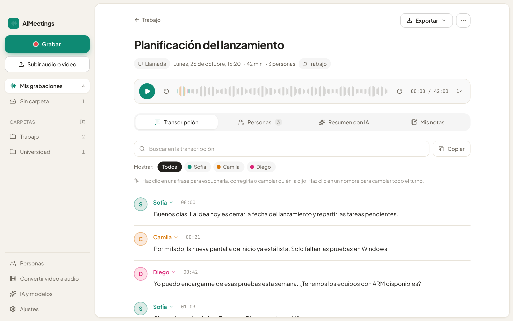

# AIMeetings

### Tus reuniones y clases, escritas solas. Con quién dijo qué.

Graba, transcribe y resume en tu propio computador.
Sin bots que se unen a la llamada y sin subir tu audio a ninguna parte.

[**Descargar para Mac**](https://github.com/sorodriguezz/AIMeetings/releases/latest) ·
[**Descargar para Windows**](https://github.com/sorodriguezz/AIMeetings/releases/latest)

 

<picture>
  <source media="(prefers-color-scheme: dark)" srcset="docs/screenshot-dark.png" />
  
</picture>

 

## Concéntrate en la conversación, no en tomar apuntes

Pulsa **Grabar** y olvídate. Al terminar tendrás toda la conversación escrita, ordenada por
persona y lista para buscar, copiar o compartir.

## Lo que puedes hacer

🎙️ **Grabar cualquier llamada**
Teams, Meet, Zoom, WhatsApp… Captura tu voz y la de los demás a la vez. También sirve para
reuniones en persona y clases.

👥 **Saber quién dijo qué**
AIMeetings separa las voces por sí solo. Ponle nombre a cada persona una vez y la reconocerá en
tus próximas grabaciones.

✨ **Resúmenes en un clic**
Pide un resumen, un acta con los acuerdos, apuntes de estudio, conceptos clave o preguntas de
repaso. Usa la IA que ya tienes o una que funciona dentro de tu computador.

🎬 **¿Tienes un video de la reunión?**
Súbelo tal cual. AIMeetings saca el audio y lo transcribe. También puedes convertir videos a audio
liviano para guardarlos o compartirlos.

🔒 **Privado de verdad**
La transcripción se hace en tu equipo. Marca una grabación o carpeta como privada y nada saldrá de
tu computador, ni siquiera para resumirla.

📁 **Todo en orden**
Carpetas, búsqueda en todo lo que se dijo, tus propias notas en cada grabación y exportación a
texto o subtítulos.

## Empezar en tres pasos

1. **Descarga** AIMeetings para tu sistema.
2. **Ábrela** y deja que te recomiende los modelos que mejor funcionan en tu equipo.
3. **Pulsa Grabar.** Eso es todo.

## Descargar

| Tu equipo | Archivo |
|---|---|
| Mac con Apple Silicon (M1, M2, M3, M4…) | `AIMeetings_x.y.z_aarch64.dmg` |
| Windows (la mayoría de los PC) | `AIMeetings_x.y.z_x64-setup.exe` |
| Windows con procesador ARM (Snapdragon) | `AIMeetings_x.y.z_arm64-setup.exe` |

Todos están en la [página de descargas](https://github.com/sorodriguezz/AIMeetings/releases/latest).
La app se actualiza sola cuando hay una versión nueva.

<b>¿El sistema no te deja abrirla?</b>

 

- **Mac**: si dice que no puede verificar al desarrollador, haz clic derecho sobre AIMeetings en
  Aplicaciones y elige **Abrir**. Solo hay que hacerlo la primera vez.
- **Windows**: si aparece "Windows protegió su PC", pulsa **Más información** y luego
  **Ejecutar de todas formas**.

 

Hecho para quienes prefieren escuchar antes que escribir.

